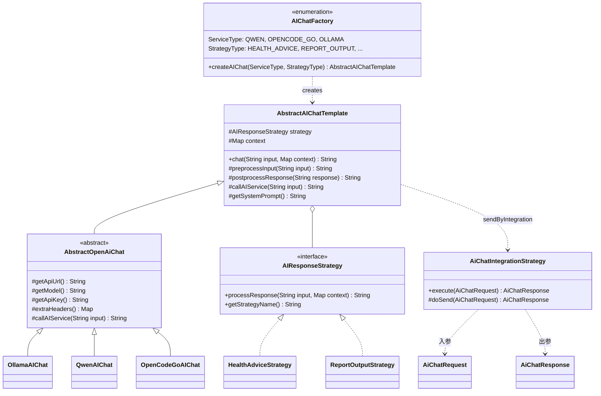

# AI对话系统类图

## 类图说明

此设计结合了策略模式、模板方法模式、工厂模式，并按服务商拆分包：

- **策略模式**: `AIResponseStrategy` 接口及其实现类，用于处理不同场景的响应逻辑（健康建议、报表输出、财务分析、成绩分析等）
- **模板方法模式**: `AbstractAIChatTemplate` 定义 AI 对话基本流程；`AbstractOpenAiChat` 封装 OpenAI 兼容协议（chat/completions）的公共实现
- **工厂模式**: `AIChatFactory` 按 `ServiceType`（服务商）+ `StrategyType`（业务场景）创建实例
- **集成日志**: AI 实例由工厂 `new` 创建、非 Spring Bean，因此 HTTP 调用统一走 `AiChatIntegrationStrategy`（Spring Bean，标注 `@IntegrationLog`），由切面自动记录集成日志

## 包结构

```
com.hms.ai
├── factory/     AIChatFactory（ServiceType: QWEN / OPENCODE_GO / OLLAMA）
├── strategy/    AIResponseStrategy 及各业务策略
├── template/    AbstractAIChatTemplate（模板方法骨架）
├── core/        AbstractOpenAiChat（OpenAI 兼容协议公共实现，含图片/视频）
├── qwen/        QwenAIChat（DashScope）、QwenChat（流式）
├── opencodego/  OpenCodeGoAIChat（携带 x-opencode-session）
└── ollama/      OllamaAIChat、OllamaChat
com.hms.main.integration.ai
├── AiChatRequest             AI 请求（地址/报文/请求头/服务商/模型）
├── AiChatResponse            AI 原始响应
└── AiChatIntegrationStrategy AI 集成策略（@IntegrationLog，自动落库）
```

## 类图结构



## 使用方式

```java
// 显式指定服务商（当前生产使用 OpenCode Go）
AbstractAIChatTemplate aiChat = AIChatFactory.createAIChat(
        AIChatFactory.ServiceType.OPENCODE_GO,
        AIChatFactory.StrategyType.Reminder);
String response = aiChat.chat(req, null);
```

## 服务商配置（application.yml）

| 配置前缀 | 说明 | 对应实现 |
| --- | --- | --- |
| `ai.qwen` | 通义千问 DashScope | `QwenAIChat` |
| `ai.opencode-go` | OpenCode Go 代理（自动携带 `x-opencode-session`） | `OpenCodeGoAIChat` |
| `ai.ollama` | 本地 Ollama（host/model） | `OllamaAIChat` |

## 集成日志

AI 实例由 `AIChatFactory` 通过 `new` 创建（非 Spring Bean），无法被 `@IntegrationLog` 切面直接拦截，因此所有服务商的 HTTP 调用统一收敛到 `AiChatIntegrationStrategy`（Spring Bean，标注 `@IntegrationLog`），经 `AbstractAIChatTemplate#sendByIntegration` 调用：

```java
// 各服务商构造请求后统一走集成策略（无需各自调 HttpUtils）
AiChatRequest request = new AiChatRequest(getApiUrl(), json.toString(), headers, getProvider(), getModel());
request.setBillId(resolveBillId());
String ret = sendByIntegration(request);
```

落库字段对应关系（系统管理 → 日志管理 → 集成日志）：

| 字段 | 取值 |
| --- | --- |
| title | `AI对话` |
| bizType | `AI` |
| sender | `HMS` |
| receiver | `服务商/模型`，如 `opencode-go/deepseek-v4.1-flash` |
| billId | 业务单号优先：调用方在 context 传 `billId`（如 `score-123`、`reminder-标题`、`weather-2026-10-19`、`finance-用户-日期`）；缺失时由策略兜底生成 `AI-yyyyMMddHHmmss-xxxx`，保证不为空 |
| sendMessage | 实际请求报文（含图片/视频时为 base64，超长按 65535 截断） |
| responseMessage | AI 原始响应报文 |
| status / errorMsg | 切面按异常自动标记成功/失败 |

> 非 Spring 上下文（如直接运行 `AIChatTest.main`）会降级为直连，不记录集成日志，不影响调用。
> 新增服务商只需实现 `getProvider()` 并提供模型信息，无需再关心日志。

### 单据标识（billId）约定

按"业务单号优先、缺失兜底生成"处理，解析链：`context.billId` → `context.sessionId` → 策略兜底 `AI-yyyyMMddHHmmss-xxxx`。

| 调用场景 | 单据标识 | 位置 |
| --- | --- | --- |
| 八段锦打分 | `score-{记录ID}` | `HmsScoreRecordServiceImpl` |
| 提醒生成 | `reminder-{提醒标题}`（与提醒邮件一致） | `ReminderTask` |
| 天气推送 | `weather-{yyyy-MM-dd}`（与天气邮件一致） | `WeatherBaseTask` |
| 财务分析 | `finance-{用户ID}-{yyyy-MM-dd}` | `HsmSummaryController` |
| 记账图片识别 | 兜底生成 | `HsmJotdownController`（暂无业务单号） |

> 同一业务同时产生 AI 与邮件日志时，使用相同单据标识，便于在集成日志中串联排查。

### 天气播报角色池（每日随机）

`DragonRajaWeatherStrategy`（`StrategyType.DRAGON_RAJA_WEATHER`）按日期从角色池里选一位来写气象简报：

| key | 角色 | 视觉基调 |
| --- | --- | --- |
| `chuzihang` | 楚子航 | 黑钢夜雨、银白刀光 |
| `caesar` | 凯撒·加图索 | 黑金大理石、贵族简报 |
| `lumingfei` | 路明非 | 浅色雨天宿舍、微丧 |
| `finger` | 芬格尔 | 暖橙食堂、贫嘴推销 |
| `nonno` | 诺诺 | 酒红夜色、直接随性 |
| `noma` | 诺玛 | 终端绿、系统播报 |
| `huiliyi` | 上杉绘梨衣 | 白樱粉、纸鹤便签、短句 |
| `genzhisheng` | 源稚生 | 冷蓝雨夜、执行令 |
| `angers` | 昂热校长 | 深绿黄铜、老图书馆、绅士腔 |

- 选角用 `LocalDate`（epochDay 作随机种子），**同一天稳定、跨天换人**，避免邮件与微信不是同一位
- 调试指定角色：JVM 参数 `-Dweather.persona=caesar`（也支持中文名，如 `-Dweather.persona=诺诺`）
- 输出契约仍是「HTML + `[IMAGE_PROMPT]`」，`SendMaillTask` / `WxMsgTask` 无需感知具体角色
- 想固定某一位或换回新海诚风格时，改 `WeatherBaseTask#getStrategyType()` 即可

## 设计优势

- 服务商协议公共部分集中在 `AbstractOpenAiChat`，新增 OpenAI 兼容服务商只需实现 apiUrl/model/apiKey/额外请求头
- 业务场景与 AI 服务商解耦，可自由组合
- 通过 `ServiceType` 显式选择服务商，避免默认值误用
